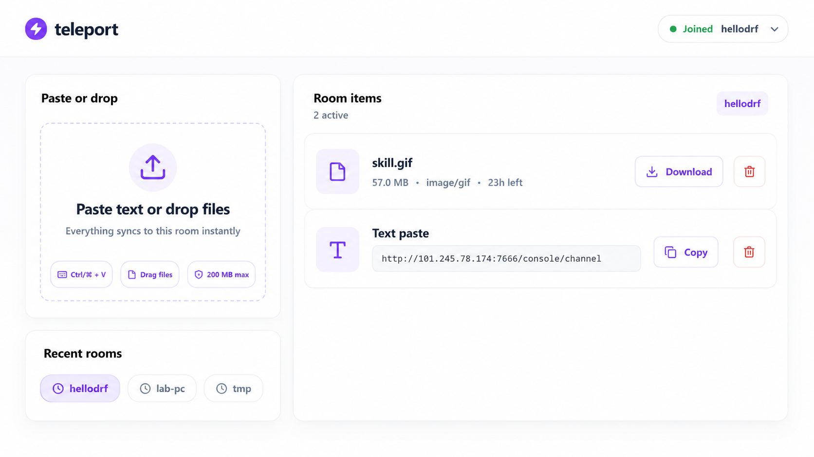

# teleport

[](https://github.com/acore2026/teleport/actions/workflows/ci.yml)
[](https://github.com/acore2026/teleport/pkgs/container/teleport)

**teleport** is a fast room-based paste and file shuttle for the web. Create or join a room, paste text, drop files, and every connected client sees the same recent items instantly. Items expire automatically after 24 hours, so rooms stay lightweight.



## Highlights

- Real-time room sync over Server-Sent Events.
- Text pastes, file drops, image paste support, image previews, and one-click copy/download.
- Configurable chunked file uploads, enabled by default with 50 KB chunks for unreliable connections.
- 24-hour auto-destroy for every item.
- Lightweight room model: no account system, no device list, no generated share flow.
- Client-side text encryption before upload; files are transferred and stored as uploaded.
- Production Docker image with nginx in front of the Node API.

## Quick Start With Docker

```bash
docker compose up -d --build
```

Open:

```text
http://localhost:7777/
```

Or build and run manually:

```bash
docker build -t teleport:production .

docker run -d \
  --name teleport \
  --restart unless-stopped \
  -p 7777:7777 \
  -v teleport-data:/app/data \
  teleport:production
```

The container serves the web UI on port `7777`, proxies `/api/*` to the internal Node server, and accepts files up to `200 MB`.

## Local Development

Requirements:

- Node.js `24+`
- npm

Install dependencies:

```bash
npm install
```

Run the web app in development:

```bash
npm run dev
```

Build the frontend and server:

```bash
npm run build
```

Run the compiled server:

```bash
npm start
```

## Verification

Run `npm test` to build the frontend and server and exercise the room API, SSE updates, file download, deletion, and 24-hour expiry cleanup against temporary SQLite storage.

## Project Structure

```text
src/                 Vue/Vite frontend
src/main.ts          Vue bootstrap
src/App.vue          Renders the web workspace
src/components/      Layouts, room forms, item cards, and prompts
src/composables/     Room feed, text cache, and app coordination
src/lib/             API, uploads, text codec, storage, and clipboard helpers
src/types.ts         Frontend domain types
src/config.ts        Client defaults and persistent setting keys
public/favicon.svg   Browser tab icon
src/styles.css       Global light theme and responsive layout
server/index.ts      Starts the server and schedules expiry cleanup
server/app.ts        HTTP routes, uploads, and error handling
server/database.ts   SQLite schema, migrations, and prepared statements
server/rooms.ts      Item serialization and room payloads
server/events.ts     SSE channels and broadcasts
server/cleanup.ts    Expired item and file cleanup
server/files.ts      File naming, hashing, and removal
server/config.ts     Runtime paths, limits, and environment settings
docker/              nginx config and container entrypoint
docs/assets/         README screenshots and design references
.github/workflows/   CI and Docker image publishing
data/                Local runtime data, ignored by git
```

## Configuration And Data

Web/server runtime data is stored under `data/` locally. In Docker, keep the `/app/data` volume mounted so uploads and SQLite data survive container replacement.

Room passwords and upload preferences are stored in the browser.

## GitHub Builds And Releases

The repository ships with two workflows:

- `CI`: checks the web/server build and Docker image build.
- `Publish`: publishes the Docker image to GitHub Container Registry.

Publish a release:

```bash
git tag v1.0.1
git push origin v1.0.1
```

Docker images are published as:

```text
ghcr.io/acore2026/teleport:latest
ghcr.io/acore2026/teleport:v1.0.1
ghcr.io/acore2026/teleport:sha-<commit>
```

## Notes

- Room names may contain letters, numbers, hyphens, and underscores.
- Items expire after 24 hours and are cleaned automatically.
- Maximum text size is `1 MB`.
- Maximum file size is `200 MB`.
- Uploaded files and SQLite databases should never be committed.
